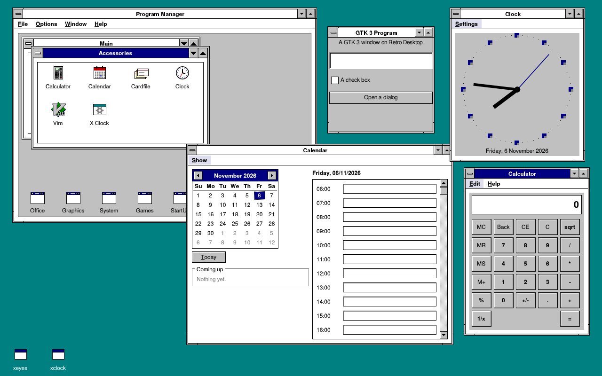
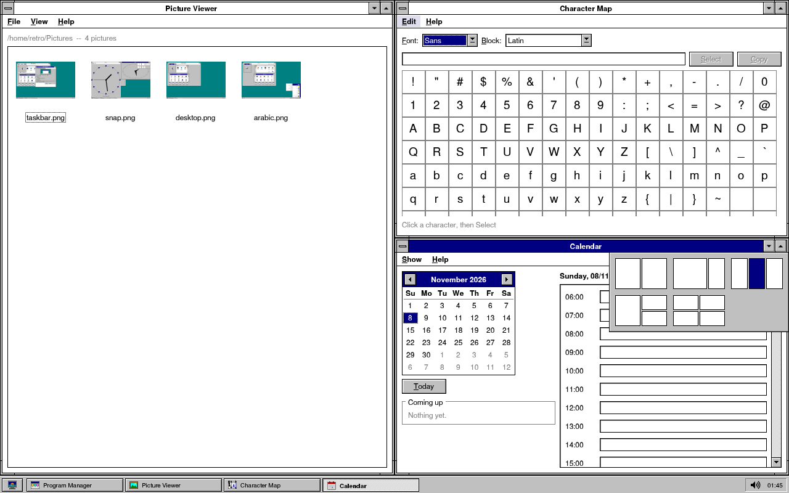
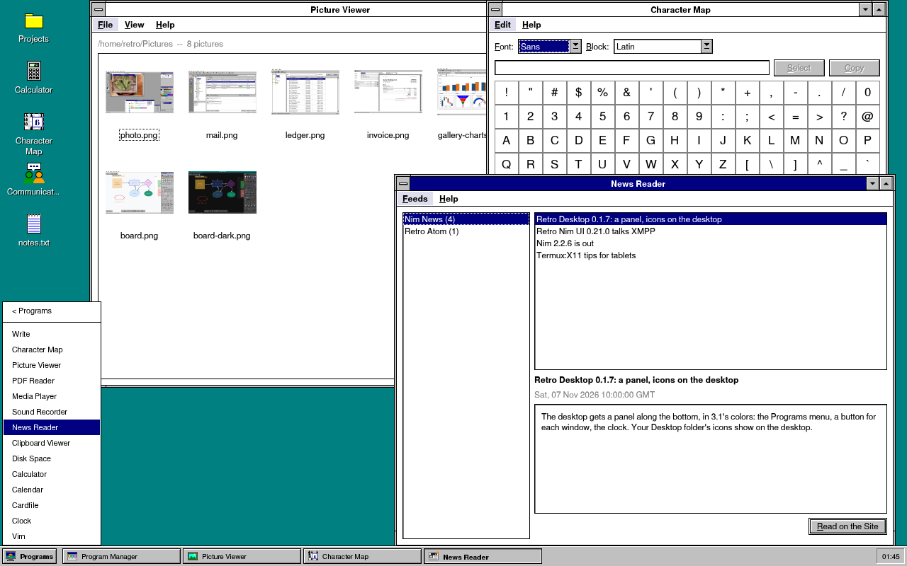
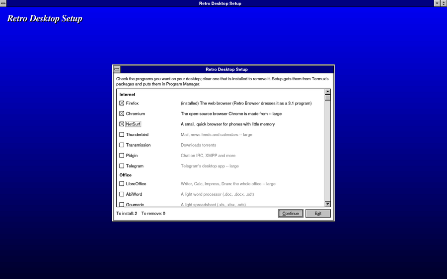
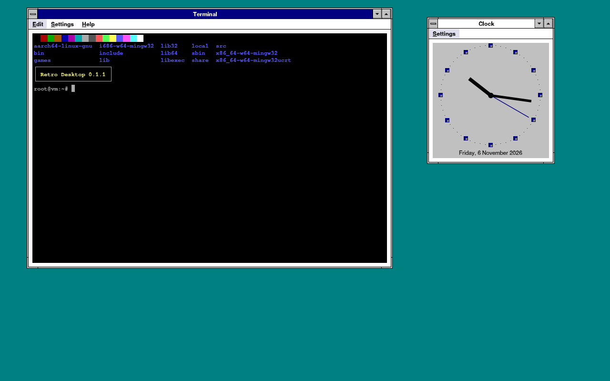
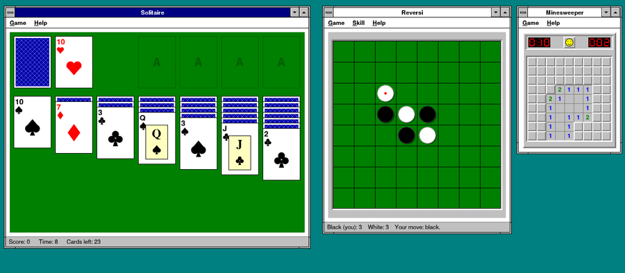
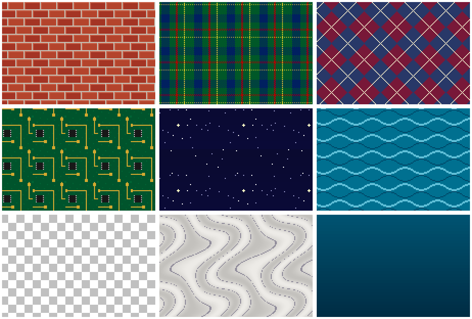
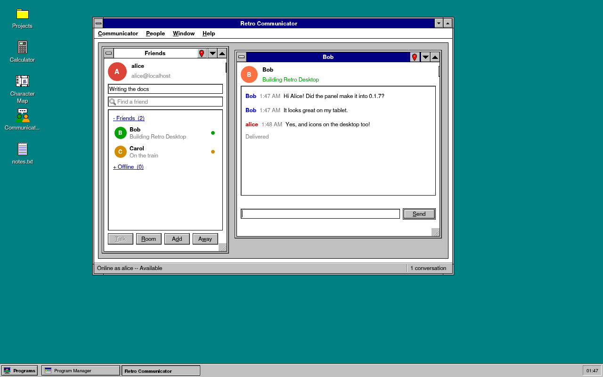
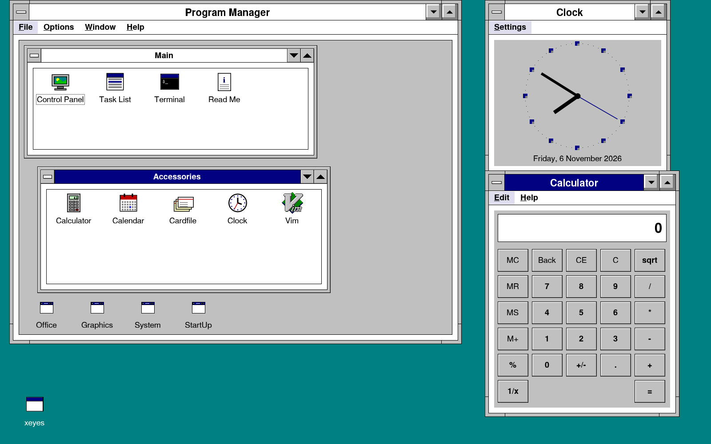

# Retro Desktop

A Windows 3.1 style desktop for Linux -- made first for **Termux on
Android** (Termux:X11), so a phone or a tablet has a whole desktop: every
X11 program in a 3.1 window, Program Manager with the programs you
install, and the small programs a desktop comes with.



I made it with my own toolkit, [Retro Nim UI](https://github.com/foxoman/retroui):
one program of about 5 MB, nothing to set up.

## What is in it

- **The window manager.** Every program's window gets the 3.1 frame: the
  title bar to move it by, the border and the corners to size it by, the
  control-menu box (Restore, Minimize, Maximize, Close, Switch To), and
  Windows 95's minimize, maximize and close buttons (the close button asks
  the program to close, as Alt+F4; Control Panel > Desktop gives 3.1's
  two instead, without a close button). Minimized windows are buttons on the
  panel (or, with the panel off, icons along the bottom of the desktop, as
  3.1 had them). Click to bring a window to the front; Alt+Tab
  shows 3.1's box with the next window while Alt is held; Alt+F4 closes
  one. Every window can be sized -- by its border, a corner, the top of its
  title bar, or Alt with the right button; Alt with the left button moves
  it from anywhere. Windows snap to the screen's edges and to each other as
  you move them. Dialogs open over their windows, programs that go full
  screen (videos, games) get the whole screen, and the windows follow when
  the tablet turns. The programs open when the desktop ended -- you exited,
  or Android stopped Termux -- open again where they were the next time.
- **Snapping as in Windows 11:** drag a window to the left or right edge
  and it fills that half, to a corner that quarter, to the top the whole
  screen (a frame shows where first); then the other windows are offered
  for the rest. Rest the pointer on the maximize button (or press Win+Z)
  for the layouts -- halves, two thirds and a third, thirds, a half and two
  quarters, quarters -- and click a part. Win+arrows move a window between
  the halves and quarters as Windows 11 does; dragged away, a window comes
  back to its own size.

  
- **The panel**, Windows 95's taskbar in 3.1's colors: the **Start**
  button (the desktop's picture, no word on it) opens the Start menu as
  95's -- Programs (every group of Program Manager, each opening beside
  it, each program with its icon), Documents (the files opened last),
  Settings, Find, Help, Run, Shut Down -- with the band down its side and
  large pictures. A button for each window, the tray, the clock (resting on
  it: the date). Drag it to any edge -- bottom, top, left, right --, make it
  taller or wider by its inner edge; a right click on it: Cascade, Tile,
  Minimize All Windows, Task List, Properties (Always on top, Auto hide,
  small pictures in the Start menu, the clock). Control Panel > Windows
  turns it off.
- **Icons on the desktop:** what is in your Desktop folder -- folders,
  files, programs -- where you drag them; Program Manager's File > Put on
  the Desktop makes a program's icon.

  

- **Program Manager**, with the groups 3.1 had -- Main, Accessories,
  StartUp -- and a group for each kind of program you install: Internet,
  Office, Development, Graphics, Multimedia, System, Games. Every program
  installed with a desktop entry is there by itself (Firefox, VS Code,
  GIMP, LibreOffice...). File > New puts in programs of your own; StartUp
  starts them with the desktop. The **Android** group has the apps on your
  phone (a double click opens one on Android).
- **Setup**, as 3.1's: the blue screen, the programs to choose (browsers,
  office, development, graphics, music and video, games, fonts), the space
  they need and the space there is, a gauge while they go in -- and
  Termux's packages (apt, as `pkg` runs it) doing the work underneath.
  Clear a program that is installed to remove it. Retro Browser asks to
  install Firefox through it when Firefox is not there.

  

- **Terminal**, the desktop's own: the shell in a PC's 16 text colors
  (black on white, as Windows had it, or MS-DOS Prompt's gray on black), for everything from
  `ls` to vim, nano, htop and mc -- xterm's escape sequences, 256 and 24-bit
  colors, the mouse, a scrollback, copy and paste (Ctrl+Shift+C, V).

  

- **Retro Browser:** Firefox dressed as a 3.1 program -- gray toolbars,
  square raised buttons, tabs like buttons, a sunken address field, the menu
  bar, the desktop's colors, scroll bars always there -- on a profile of
  its own, so your own Firefox stays as it is (`pkg install firefox`).
- **The accessories:** Write (a word processor: bold, italic, sizes,
  colors, lists; Word documents (.docx) opened and saved, HTML or plain
  text), Clock, Calculator, Calendar (with appointments and notes; the
  Hijri date beside the other, Control Panel > Date/Time), Cardfile, Clipboard Viewer (and Android's
  clipboard, with Termux:API), Task List (Ctrl+Esc: every window and the
  memory its program takes; End Task ends one that hangs), Control Panel
  (with Date/Time and the screen savers: Blank Screen, Starfield, Mystify,
  Marquee), Character Map, Picture Viewer (thumbnails, a slide show, set as
  wallpaper, send to Android), PDF Reader, Media Player (mpv underneath),
  Sound Recorder, News Reader (RSS and Atom), Disk Space (what fills the
  storage), Share Desktop (this desktop on a computer, through VNC), and on
  a phone, with Termux:API, Camera and Phone Dialer (calls, contacts, the
  messages as conversations, the call log). Write and Notepad print to PDF.
- **The games:** Minesweeper, Solitaire (Klondike, the bouncing cards
  when you win) and Reversi, drawn for a mouse and for a finger; Freedoom
  (a free Doom, from Setup); and a **DOS** group: install DOSBox-X with
  Setup, put your DOS games in the folder `DOS` in your home, a folder
  each, and they are there, a double click away.

  

- **Sounds, wallpapers, colors:** chimes of the desktop's own for its
  events (Control Panel > Sound; through PulseAudio or Android), nine
  pixel-art wallpapers (Bricks, Tartan, Argyle, Circuit, Starry Night,
  Waves, Checkers, Marble, Sunset) and more color schemes (Emerald City,
  Rose, Slate, Bordeaux, Canyon, Tweed, Leather, Neon, and Sunlight for a
  phone outdoors, beside Hot Dog and the rest); night colors -- another
  scheme between the hours you choose; fonts of your own (Control Panel >
  Fonts > Add a Font).

  

- **Help everywhere:** F1 (or Help > Help Topics) in every program opens
  its page of Help, with links between the pages; the first start offers a
  short tour.
- **Opening files and links:** a file opened from File Manager (or a link
  from any of the desktop's programs) goes to the program for its kind --
  the one you chose ("Always use this program"), else the one that says it
  takes it, else the Open With box (in Termux, an Android app too).
- **From Retro Nim UI's examples:** File Manager (Retro Files), Paintbrush
  (Retro Photo), Board (Retro Board), Notepad, Mail (Retro Mail: Microsoft
  365, Outlook.com, Gmail) and Communicator (Retro Communicator: chat on
  XMPP -- an account on any public server, made from inside it if you
  like; friends, groups, rooms, away messages, files, voice messages, your
  history brought in from the server when you sign on, and end-to-end
  encryption with OMEMO, as Conversations and the others do it).

  

- **English or Arabic:** Control Panel > International puts the desktop's
  programs, its menus, the frames' titles and Help in Arabic, right to
  left -- the panel too: Start at the right, the tray at the left.
- **The same look for the other programs.** GTK programs (and Chromium,
  Electron, Firefox) get the color scheme as a "Retro31" GTK theme with
  3.1 scroll bars (always there, with arrows), the 3.1 cursors at the
  screen's size, the desktop's fonts (GNU FreeFont) and its size; Qt and older X programs get
  the size and the fonts. Control Panel changes the scheme, the fonts, the
  text size and the size of everything, and every program of the desktop
  follows at once.
- **Made for phones and tablets.** The size follows the screen's density
  (a 2K tablet is not tiny); frames for fingers (taller title bars, wider
  borders, icons that open with one tap); hold a finger on a title bar for
  its menu; windows that open maximized on a phone's screen; Termux kept
  awake (termux-wake-lock); the memory watched -- when the phone runs
  short the desktop lets its caches go and says so, and Task List shows
  which program holds what (its own share: what it alone holds, and its
  part of what the programs share). At rest the desktop takes no CPU and
  about 15 MB; Clock, Calculator and the others about 6 MB each.
  Program Manager keeps the icons it drew (`~/.cache/retrodesktop`), so
  it opens quicker the next time; it comes first at the start, the other
  programs after it. Minimized programs can be paused (Control Panel >
  Windows): no CPU, no battery, until you bring them back. OpenGL programs
  can draw on Android's GPU (Setup > System > 3D graphics: VirGL; the
  desktop starts its server).
- **The keyboard:** the Windows key and Ctrl+Esc open the Start menu; Win+R,
  Win+E, Win+D, Win+L, Win+arrows (halves, quarters, maximize, minimize),
  Win+Z (the layouts), Ctrl+Alt+T,
  Ctrl+Shift+Esc -- Control Panel > Keyboard changes them. English and
  Arabic (or other layouts) with Alt+Shift, the panel showing EN or ع; how
  fast a key repeats.
- **The panel's tray:** the layout, the volume, Wi-Fi, the notifications
  (a bell; a click lists them), the battery, the clock.
- **Looking after it:** Control Panel's System Check says what the
  programs need and whether it is there (Install for what is missing);
  Backup keeps the settings, groups, icons and fonts in one .zip, Restore
  puts them back; Setup installs a newer Retro Desktop from GitHub (the
  desktop says when one is out); a screen-saver password (Win+L locks); a
  3.1 General Protection Fault box when one of its programs fails.
- **Android:** Main > Android Files shows the phone's photos, downloads
  and documents (it asks Android the first time); Android's Back can close
  the window in front (Control Panel > Windows; off at first, because
  Termux:X11 uses Back for its keyboard); programs'
  notifications (`notify-send`) become Android notifications with
  Termux:API, or a box at the bottom of the screen.



## Install it in Termux

1. Install **Termux** and **Termux:X11** (the app: from
   [its releases](https://github.com/termux/termux-x11/releases)).
2. In Termux:

   ```sh
   pkg install x11-repo
   pkg install termux-x11-nightly libx11
   apt install ./retro-desktop_0.1.13_aarch64.deb     # the .deb from the releases
   retro-desktop
   ```

`retro-desktop` starts the X server when none runs, brings Termux:X11 to
the front, and the desktop fills its screen. Install programs with Setup
(Program Manager > Main), or as you always do (`pkg install firefox`...):
Program Manager shows them by themselves. With PulseAudio installed
(Setup > Multimedia > Sound) the desktop starts it, so programs have sound.

### So Android lets it run

Android stops programs it thinks you do not use. For a desktop that stays:

- **Termux awake:** the desktop holds Termux's wake lock while it runs
  (Control Panel > Desktop to turn it off).
- **Battery:** Settings > Apps > Termux > Battery > *Unrestricted* (and the
  same for Termux:X11).
- **The phantom process killer** (Android 12 and later stops programs
  started from Termux beyond a few): Developer options > *Disable child
  process restrictions* (Android 14), or from a computer with adb:
  `adb shell "settings put global settings_enable_monitor_phantom_procs false"`.

### Termux:X11's preferences

- *Display resolution mode:* native -- sharp text at the screen's own pixels.
- *Touchscreen input mode:* Direct touch (tap where you point) or Trackpad
  (a pointer you move).
- *Show additional keyboard:* Esc, Ctrl, Alt, Tab -- for Alt+Tab and the rest.
- *Fullscreen on device display* and *Hide display cutout*, for all of the screen.
- With a keyboard: Keyboard > *Enable Accessibility service for intercepting
  system shortcuts manually* (then turn on Termux:X11's service), so the
  Windows key and Alt+Tab reach the desktop; *Prefer scancodes when
  possible*, so other layouts (Arabic) type right. Other > *Clipboard
  sharing* (on at first) shares the clipboard with Android.

### When something goes wrong

Start `retro-desktop` again: a desktop that stopped answering is ended and
the new one takes its windows. What went wrong is in
`~/.local/share/retrodesktop/desktop.log`, and a program's failure in
`crashes.log` beside it (its box's Copy Details takes it too) -- send me
that with the issue. Control Panel > System Check shows what is missing. `pkill retro-desktop` ends the desktop and all its programs.

## Using it

| Keys | What they do |
|---|---|
| Alt+Tab | holding Alt: a box with the next window; Tab again for the one behind; let go to go there |
| Alt+Shift+Tab | the other way |
| Alt+F4 | closes the window in front |
| Alt+Esc | minimizes it |
| Win, Ctrl+Esc | the Start menu (with the panel off: Program Manager; Ctrl+Esc the Task List) |
| Ctrl+Shift+Esc | Task List |
| Win+R, Win+E, Win+I | Run, File Manager, Control Panel |
| Win+Left, Win+Right | the window on the left or right half (from the other half: back to its size) |
| Win+Up | a half to its top quarter, a bottom quarter to its half, else maximize |
| Win+Down | restore a maximized window; a half to its bottom quarter; a snapped one back to its size; else minimize |
| Win+Z | the window's layouts (the arrows and Enter choose) |
| Win+D | every window minimized (again: back) |
| Win+L | lock the screen |
| Ctrl+Alt+T | Terminal |
| Alt+Shift | the next keyboard layout |
| F1 | Help, at the page of the program in front |
| Android's Back | closes the window in front (when Control Panel > Windows says so) |
| Ctrl+Shift+C, Ctrl+Shift+V | copy and paste in the Terminal |
| Shift+PgUp, Shift+PgDn | the Terminal's scrollback |

A right click on the desktop (a finger held on it) opens its menu, over
every window: Program Manager, Task List, Control Panel, Terminal, Run...,
Cascade, Tile, Arrange Icons, Exit. Menus work as 3.1's: the underlined
letter chooses an item, the arrows and Enter too (Right opens the menu
beside, Left closes it), Esc closes. Double click a title bar to maximize a window; double click its
control-menu box to close it.

Menus open with a click or a finger, and the underlined letter, the
arrows, Enter and Esc work in them as in 3.1.

Every part is also a command: `retro-desktop progman`, `control`,
`tasklist`, `terminal` (`terminal -e command` runs a command in it),
`browser` (Retro Browser; pages to open after it), `setup` (`setup gimp`:
one program at once), `write` (a document after it), `open` (a file or a
link, in its program), `clipboard`, `mines`, `solitaire`, `reversi`,
`run`, `help` (a topic after it), `tour`, `storage` (Android Files), `notify`
(as `notify-send`), `sound` (an event's sound), `clock`, `calc`, `calendar`,
`cardfile`, `charmap`, `pictures` (pictures or a folder after it), `pdf`
(a PDF after it), `media` (songs or videos after it), `recorder`, `camera`,
`dialer`, `news`, `diskspace`, `share`, `crash` (the box, for a role).

## On a Linux computer

It runs on any X screen with no window manager: from a text console
(`startx $(which retro-desktop)`, or `exec retro-desktop` in `~/.xinitrc`),
or in a window of your own desktop with Xephyr:

```sh
Xephyr :2 -screen 1280x800 & DISPLAY=:2 retro-desktop
```

Screen readers: with AT-SPI installed (`at-spi2-core`) and Orca running,
the desktop and its programs are read and used from Orca -- their buttons,
boxes, lists, menus and tabs, the desktop's icons and the icons of
minimized windows, the Terminal's screen as its text. Started from a
console, the desktop starts a session bus for its programs on its own.

## Building it

You need [Nim](https://nim-lang.org) 2.2 or later and
[Retro Nim UI](https://github.com/foxoman/retroui) 0.21.0 or later.

```sh
nimble install retroui
nimble build -d:release                 # bin/retro-desktop for this computer
```

The Termux package (`build/retro-desktop_<version>_aarch64.deb`) with the
programs from Retro Nim UI's examples:

```sh
sh tools/build-deb.sh
```

It has Retro Nim UI's File Manager, Paintbrush, Board, Notepad, Mail and
Communicator too (`RETRO_APPS` chooses). Mail signs in with the Microsoft
and Google app registrations it is built with: `RETRO_MAIL_MICROSOFT_ID`,
`RETRO_MAIL_GOOGLE_ID` and `RETRO_MAIL_GOOGLE_SECRET` in the environment
while it builds (the repository's secrets on GitHub). They are never in
the code; without them Mail asks for your own.

In Termux it builds on the phone (`pkg install nim clang git`); on Linux
it cross-builds for 64-bit ARM with the Android NDK (`ANDROID_NDK_HOME`) or
clang with lld and an Android sysroot (`tools/termux-cc.sh`). It uses the
Retro Nim UI checkout next to this one (`../retro`), `RETROUI_SRC`, or
clones it.

GitHub builds the package on every push and pull request
(`.github/workflows/deb.yml`), and puts it on the release when a version
tag is pushed (`git tag v0.1.13 && git push origin v0.1.13`).

## How it works

Retro Desktop is one Nim program. Started with no argument it is the
desktop: a Retro Nim UI window that fills the screen, under every other
window, and the window manager on the same X connection (Retro Nim UI's
X11 driver hands it the events of the windows it manages). Each frame is
an X window: its border drawn with plain X, its title bar drawn with the
toolkit's canvas in the toolkit's fonts and colors. The other parts --
Program Manager, the accessories, Control Panel -- are the same program
started again with an argument, each its own window in its own frame.

The look reaches other programs through what their toolkits read:
XSETTINGS (the desktop is the screen's XSETTINGS manager), the X
resources on the root window (Xft.dpi, fonts), fontconfig, and GTK 3's
settings file and a GTK theme written from the color scheme.

## Credits

Developed by Sultan Al Isaiee @foxoman -- [www.foxoman.net](https://www.foxoman.net) --
sultan@foxoman.net

MIT License (see `LICENSE`).
